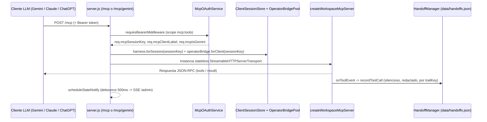

# Arquitectura Técnica — `gemini-pc-mcp`

Referencia interna de los módulos, flujos, persistencia y endpoints del servidor **PC Workspace & Operator MCP**.

---

## 1. Mapa de Módulos (`src/`)

| Archivo | Responsabilidad |
|---|---|
| `src/index.js` | Punto de entrada sin túnel ni bandeja (`npm start`), parseo de CLI args y banner de arranque. |
| `src/launcher.js` | Arranque completo del daemon (`npm run tunnel` / `Abrir-Panel.bat`): servidor + `TunnelManager` + `TrayCompanion`. |
| `src/server.js` | App Express, CORS, endpoints `/mcp`, `/mcp/gemini`, `/mcp/gemini/:slot`, aislamiento por sesión, debounce SSE (`500 ms`) y montaje de `/admin` e `/internal/tray`. |
| `src/auth.js` | Servidor OAuth 2.1 (discovery RFC 8414 + RFC 9728 PRM, DCR `/register`, consentimiento con PIN `/authorize`, `/token` con PKCE, TTL 30d, ventana de gracia de 60s en `refresh_token`) + verificación de API Keys `gp_key_*`. |
| `src/config.js` | `ConfigManager` con escritura atómica (`atomicWriteFileSync`), normalización de rutas/URLs, protección de carpetas prohibidas (`isProtectedWorkspacePath`), permisos y configuración de túnel/Operator/Full Control. |
| `src/workspace.js` | `ClientSessionStore` (overrides de workspace por sesión en memoria) y `WorkspaceHarness` (FS enjaulado, lectura multimodal texto/imagen/Office/PDF + render visual Windows, `run_command`, `git_harness`). |
| `src/mcpTools.js` | Construcción de `McpServer` por petición (`StreamableHTTPServerTransport` stateless), instrucciones operativas, workaround de annotations para Gemini Web, Resource/Prompts y registro de todas las tools. |
| `src/handoff.js` | `HandoffManager` (v2): rastros automáticos particionados por `(sessionKey, activeWorkspace)`, redacción de secretos (`redactSecrets`), checkpoints explícitos, desambiguación segura (`needsSelection`) y generación de prompts de relevo. |
| `src/processManager.js` | Gestor de demonios/consolas persistentes bajo el switch **Modo Control Total** (TTL con auto-expiración, límite de 10 procesos activos / 256 KB buffer y `taskkill /T /F` en Windows). |
| `src/operatorBridge.js` | `OperatorBridgePool`: mantiene una instancia `stdio` aislada del plugin `antigravity-operator` por `sessionKey` (`AG_OPERATOR_SESSION_KEY`), compartiendo caché de schemas de tools. |
| `src/skills.js` | `SkillCatalog`: descubre y sirve archivos `SKILL.md` (prioridad: workspace → builtin → Operator → `~/.gemini/config/skills`). |
| `src/tunnel.js` | `TunnelManager`: ciclo de vida de Tailscale Funnel, Cloudflare Named/Quick o modo local, detección de binarios, logs en anillo y bus SSE. |
| `src/admin.js` | Router estrictamente local (`127.0.0.1`, bloquea cabeceras `X-Forwarded-*`/`CF-*`) con autenticación por cookie HMAC + API JSON/SSE y router interno `/internal/tray`. |
| `src/tray.js` | Compilación bajo demanda (`.NET csc.exe`) y ejecución de `panel/tray/pc-operator-tray.exe`. |
| `src/public/*` | SPA ligera del panel `/admin` (`index.html`, `styles.css`, `app.js`, `js/api.js`, `js/render.js`). |

---

## 2. Flujo de una Petición MCP y Aislamiento

### Derivación de `sessionKey` (`src/auth.js`)
- **DCR y API Keys:** usan su `clientId` único.
- **Cliente OAuth estático compartido:** se segmenta como `static:gemini` en rutas `/mcp/gemini*` o `static:<clientName_normalizado>` para mantener aislados Claude, Gemini y ChatGPT aunque compartan credenciales estáticas.

---

## 3. Persistencia en `data/`

Todos los archivos JSON se escriben de forma atómica (`tmp` + `rename`, con fallback ante bloqueos transitorios en Windows):

| Archivo | Contenido |
|---|---|
| `data/config.json` | Puerto, PIN, cliente OAuth estático, API keys (hashes/metadatos), workspaces autorizados, permisos, configuración del túnel, ruta de Operator y estado de `fullControl`. |
| `data/auth-state.json` | Clientes DCR registrados, `access_token` / `refresh_token` activos y ventana de gracia de refresh (60 s). |
| `data/handoffs.json` | Esquema v2: `trails` (mapa por `trailKey = "<sessionKey>::<sha1(workspace)[0..8]>"`, máx. 30) y `checkpoints` (máx. 25), con secretos redactados. |
| `data/runtime.json` | Estado de ejecución del túnel/daemon actual escrito por `TunnelManager`. |

---

## 4. Diseño del Sistema de Handoff (`src/handoff.js`)

1. **Aislamiento total (*Pull-Only*):**
   - `workspace_info` no consulta ni expone datos de `HandoffManager`.
   - `buildMcpServerInstructions` y las descripciones de las tools prohíben invocar `handoff_*` sin petición explícita del usuario.
2. **Particionamiento y anti-mezcla:**
   - Un mismo proveedor trabajando en dos carpetas genera dos `trailKey` independientes.
   - `modifiedFiles` (`write`, `edit`, `move`, `delete`) se almacena separado de `readFiles`.
   - Tools de inspección (`workspace_info`, `list_workspaces`, `select_workspace`, `list_dir`, `process_list`, `use_skill`, `handoff_*`) se ignoran en el rastro para conservar limpia la última operación real.
   - Al retomar un `checkpoint`, solo se adjunta `liveAutoTrail` si coincide exactamente `(fromSessionKey, activeWorkspace)`.
   - Al llamar `handoff_resume()` sin filtros cuando existen ≥2 workspaces distintos activos recientes (ventana de 6 h), devuelve `{ found: false, needsSelection: true, candidates }` sin alterar `select_workspace`.
3. **Redacción de secretos (`redactSecrets`):**
   - Enmascara `Bearer`, `Basic`, `gp_key_*`, `sk-*`, `ghp_*`, `gho_*`, `github_pat_*`, `AIza*` y pares `password|passwd|pwd|secret|token|api_key|client_secret`.

---

## 5. Endpoints HTTP del Servidor

### Públicos / OAuth / MCP
- `GET /health` → `{ ok: true }` (liveness sin exponer rutas internas).
- `GET /` → estado mínimo de texto plano.
- `GET /.well-known/oauth-authorization-server`
- `GET /.well-known/oauth-protected-resource` (`[/mcp | /mcp/gemini | /mcp/gemini/:slot]`)
- `POST /register` (DCR), `GET /authorize`, `POST /authorize/confirm`, `POST /token`
- `POST /mcp`, `POST /mcp/gemini`, `POST /mcp/gemini/:slot`

### Panel Local (`/admin` — solo `127.0.0.1` + cookie de PIN)
- `GET /admin`, `POST /admin/login`, `POST /admin/logout`
- `GET /admin/api/state`, `GET /admin/api/events` (SSE en vivo)
- Túnel y red: `/api/tunnel/start`, `/api/tunnel/restart`, `/api/tunnel/stop`, `/api/tunnel/detect`, `/api/config/tunnel`
- Auth y servidor: `/api/config/server`, `/api/config/oauth`, `/api/auth/api-keys` (`POST`/`DELETE`), `/api/auth/revoke-all`
- Workspaces y permisos: `/api/config/permissions`, `/api/workspaces/add`, `/select`, `/remove`, `/pick`, `/open`, `/reset-sessions`
- Operator: `/api/config/operator`, `/api/operator/restart`, `/stop`, `/sessions/:key/stop`
- Demonios / Control Total: `/api/config/full-control`, `/api/processes/start`, `/:id/output`, `/:id/input`, `/:id/stop`, `/stop-all`, `/clear-exited`
- Handoff: `/api/handoffs/freeze`, `/api/handoffs/prompt`, `/api/handoffs/delete`
- Daemon: `/api/logs/clear`, `/api/daemon/shutdown`

### Interno de Bandeja (`/internal/tray` — solo loopback + header `X-Tray-Token`)
- Usado por `pc-operator-tray.exe` para consultar estado y ejecutar acciones rápidas (abrir panel, reiniciar túnel, apagar daemon).

---

## 6. Suite de Pruebas (`test/`)

Ejecutar con `npm test` (`node --test test/*.test.js`):
- `test/server.test.js`: OAuth 2.1, DCR, seguridad de rutas/sandbox, API keys, Operator federado, lectura multimodal (imagen/PDF/DOCX/lote), aislamiento de sesiones paralelas, Control Total / demonios, `use_skill`, TTL 30d + ventana de gracia, rutas `/mcp/gemini*`.
- `test/handoff.test.js`: cero contaminación en `workspace_info`, particionamiento por `(sesión, workspace)`, desambiguación `needsSelection`, no-mezcla entre checkpoints y trails ajenos, redacción de secretos, persistencia tras reinicio y endpoints `/admin/api/handoffs/*`.
- `test/tray.test.js`: seguridad de `/internal/tray`, assets estáticos del panel y compilación del binario de bandeja.
